# 出界硬币 · EDGE COIN

一款俯视角 2D 弹硬币游戏。十一枚硬币各有专属能力；轮流与追击模式支持 2–8 枚硬币参战，**单机齐射模式最多支持 24 枚**（硬币类型可重复，不新增硬币种类）。支持「轮流」「齐射」和本地「追击」三种模式。轮流模式发射顺序随机；齐射模式所有硬币锁定角度与力度后同时发射；追击模式在巨大的圆形迷宫中逃离 1–7 名 AI 追兵。本地与联机轮流 / 齐射还可加入固定反弹与可推动障碍物，支持长方形与手动摆放、单独调整大小和旋转。玩家出局后还可以继续观战，直到冠军诞生。

支持 **最多 8 人联机**：房主创建房间，挑战者输入 5 位房间码加入；房间可切换轮流 / 齐射，空位可以添加 AI，未满 8 人也能开始。

## 运行

本地离线游玩可以直接双击 `index.html`，无需安装依赖。

要使用联机，需要运行分享包内的零依赖 Node 服务器：

```bash
node server.js
```

然后打开 <http://localhost:8130/>。这个地址同时提供游戏页面和联机房间 API。

- 在局域网联机时，把 `localhost` 换成房主电脑的局域网 IP，例如 `http://192.168.1.20:8130/`，并允许防火墙放行 8130 端口。
- 房主创建房间后会自动复制 **邀请链接**（服务器会自动选择可用的局域网 IP）。朋友直接打开链接就会自动加入；也可以手动输入 5 位房间码。
- 只有静态文件、没有 Node 服务器时，联机按钮会提示无法连接。
- 单文件 `EDGE-COIN.html` 适合离线/本地对战；联机请使用完整包。
- 端口可用环境变量覆盖：`PORT=9000 node server.js`。
- 需要把联机开放到公网时，见 [DEPLOY.md](DEPLOY.md)：可直接部署到 Render，也可以用 Docker / VPS 或临时隧道。

推荐使用鼠标 + 键盘在桌面端游玩。

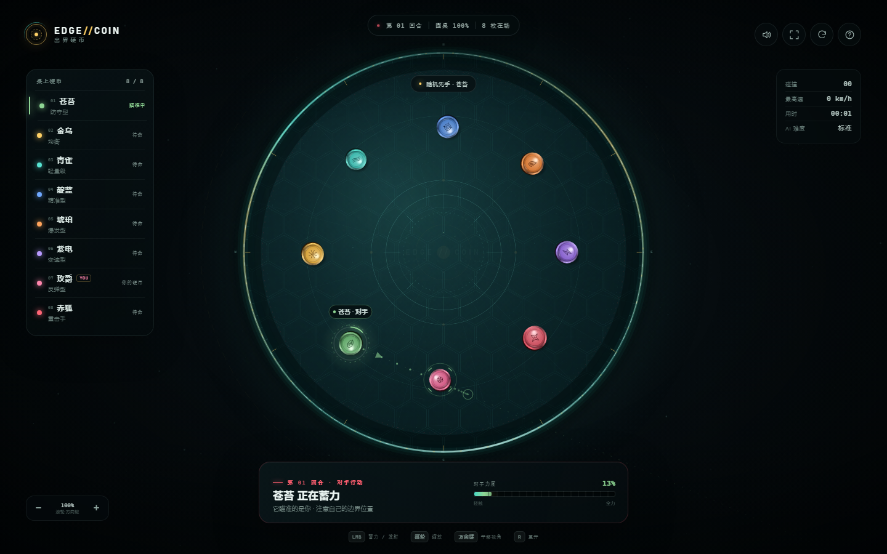

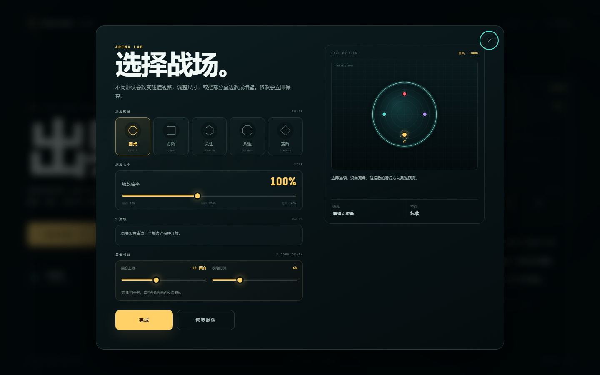

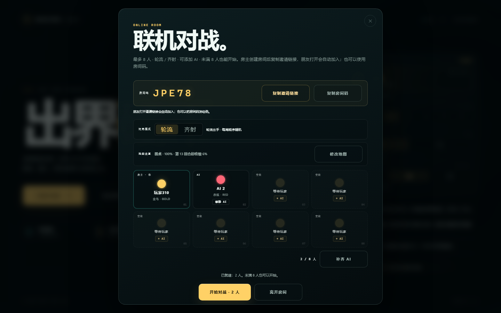

## 操作

| 操作 | 效果 |
| --- | --- |
| 主菜单「图鉴 / 更换」 | 打开硬币图鉴，查看技能并选择角色 |
| 主菜单「联机」 | 创建房间，或输入房间码加入最多 8 人的联机对战 |
| 主菜单 `2–8` / 齐射滑杆 `2–24` | 设置本局硬币数量；单机齐射最多 24 枚 |
| 主菜单「轮流 / 齐射 / 追击」 | 切换对局模式；追击模式为本地玩法 |
| 主菜单「生命值」 | 追击模式中设置 1–5 点生命 |
| 主菜单「场地」 | 切换形状、尺寸、边界墙、障碍物与回合收缩（追击模式使用固定迷宫） |
| 移动鼠标 | 决定发射方向 |
| 按住鼠标左键 | 蓄力 |
| 松开鼠标左键 | 轮流模式发射；齐射模式锁定角度与力度 |
| 鼠标瞄准 + 按住左键 | 追击模式中蓄力，松开后弹射 |
| 鼠标右键 / `Esc` | 取消蓄力 |
| 鼠标滚轮 | 以光标为中心缩放战场 |
| `↑` `↓` `←` `→` | 轮流/齐射中平移视角（追击模式用鼠标瞄准） |
| `+` / `-` 或左下角按钮 | 缩放 |
| `C` 或点击本局硬币名单 | 暂停并查看任意硬币的技能与本局状态 |
| 顶部「AI 性格」按钮 | 普通对战中暂停查看每名 AI 的性格与说明 |
| `E`（回声） | 自己的回合留标；之后敌人回合任意时刻再按一次折返 |
| `E`（锚星） | 滑行中急停，随后二次瞄准发射；冷却 4 回合 |
| `Q` / `E`（流萤） | 滑行中向左 / 向右偏转，按住越久转向越强；每秒消耗 5 能量 |
| `R` | 重新开局 |
| 顶部「退出」按钮 | 所有单机模式中打开退出确认，可返回主菜单 |
| `M` | 静音 / 开启声音 |
| `F` | 全屏 |
| `H` | 玩法说明 |
| `Esc` | 关闭说明 / 从结算返回菜单 |

方向键会平移视角：按哪个方向，视野就向哪个方向移动，场地会相应向反方向移动，避免底部回合栏或角落 HUD 挡住硬币。每回合开始时，镜头还会自动把当前行动的硬币拉回可见区域。

## 局内退出

所有**单机模式**（轮流、齐射、追击）对局中，右上角都会显示退出按钮。点击后会暂停对局并弹出确认：

- **继续对局**：回到当前对局，进度保留。
- **退出到主菜单**：放弃本局并返回主菜单。
- 按 `Esc` 也可以取消退出。
- 结算界面不显示该按钮；联机模式使用独立的「离开房间」按钮。

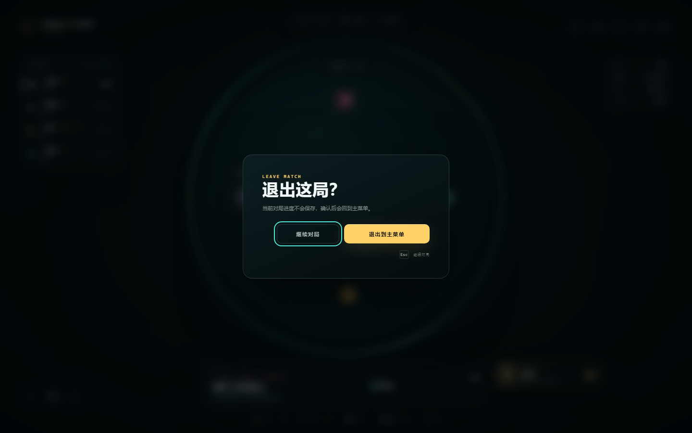

## AI 性格

普通**轮流 / 齐射**对战中（含联机），每名 AI 会随机获得一种性格，**允许重复**。联机时由房主统一分配并同步给所有玩家，性格不会用于追击模式。联机中打开性格列表不会暂停比赛。

- **贪心** — 总挑最近的目标，追求立刻撞到。
- **稳妥** — 场上存活硬币 ≥4 时前往中央；少于 4 时直接攻击玩家。
- **暴怒** — 优先撞最近的对手，力度更猛。
- **懒惰** — 出手更慢、力度更轻，经常敷衍。
- **随机** — 目标和力度都随机。
- **聪明** — 预判对手走位，更偏向边界和玩家。
- **黑狗** — 全能战术 AI：按当前硬币的技能选择目标、力度和打法，会抢先处理靠近边界的对手，也会用流萤主动偏转、用回声留标折返。出场时会伴随暗红色闪电、冲击波与「黑狗」标记。
- **喵喵** — 随性乱撞，偶尔喵一声并播放猫叫音效。

菜单中的 **AI 性格池** 可以勾选本局允许出现的性格：

- 至少保留一种，避免没有可用性格。
- 勾选范围内允许重复，例如只勾选黑狗，则所有 AI 都是黑狗。
- 设置会自动保存。
- 联机时使用房主的性格池，其他玩家通过快照看到实际分配结果。

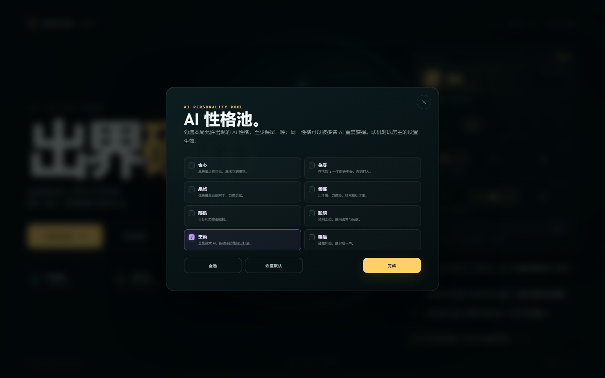

对局中点击右上角的 **AI 性格** 按钮，会暂停对局并列出每名 AI 的硬币、性格与说明；按 `Esc` 或「继续对局」返回。

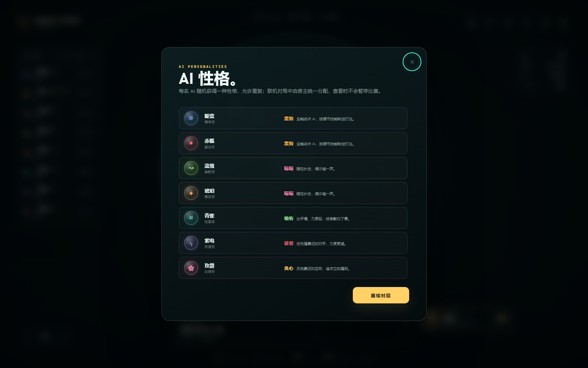

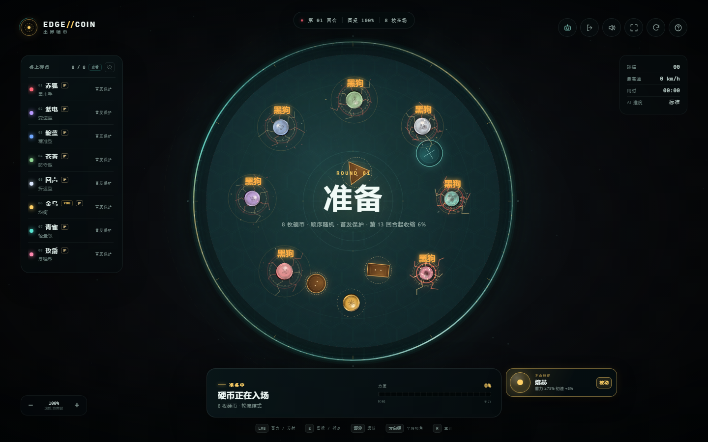

## 可选角色与技能

每枚硬币都有独立的重量、初速、定位和一个**专属能力**。主菜单打开「硬币图鉴」可查看完整说明。

- **金乌 · 均衡** — 技能「熔芯」：蓄力达到 75% 或更高时，发射初速提高 8%。
- **赤狐 · 重击手** — 技能「破阵」：撞向对手时，把额外 20% 的冲击力灌向对手。
- **青雀 · 轻量级** — 技能「掠影」：滑行阻力降低 20%，同等力度下滚得更远。
- **紫电 · 变速型** — 技能「余弧」：每一杆第一次撞到硬币后，自身速度提高 7%。
- **玫爵 · 反弹型** — 技能「镜壁」：撞墙时保留 84% 法向速度，并保留更多切向速度。
- **苍苔 · 防守型** — 技能「苔甲」：被其他硬币撞击时，受到的冲量减少 22%。
- **靛蓝 · 精准型** — 技能「定轨」：力度处于 50%–78% 时，发射初速提高 10%。
- **琥珀 · 爆发型** — 技能「孤注」：力度达到 90% 时初速提高 16%，但这一杆的滑行阻力增加 14%。
- **回声 · 折返型** — 技能「折返」：自己的回合按 `E` 在原地留标，标记会跨回合保留；之后在敌人回合的任意时刻再按 `E`，回到标记点并保留按下瞬间的运动状态。两段都使用完后进入 3 个自己回合的冷却；AI 控制时会自动留标并在敌人回合折返。
- **流萤 · 操舵型** — 技能「偏流」：拥有 `100` 点能量。硬币滑行时按住 `Q` 向左偏转、按住 `E` 向右偏转，按得越久转向幅度越大；每秒消耗 `5` 点能量，20 秒耗尽。偏转时会留下明亮的青绿色拖尾。联机中由房主模拟，访客输入会实时转发。
- **锚星 · 截击型** — 技能「急停」：硬币滑行过程中按 `E`，立刻停在按下瞬间的位置，并进入一次额外的瞄准与发射；二次发射后本回合结束。技能冷却 4 回合。急停后硬币仍可能被其他硬币撞击。

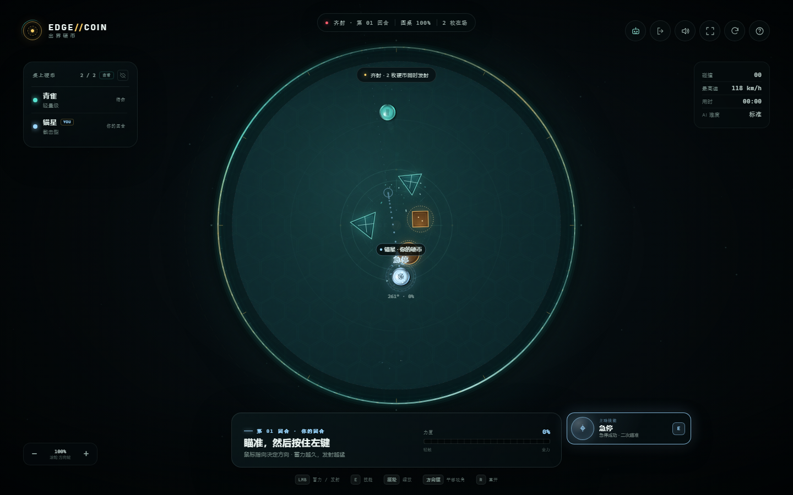

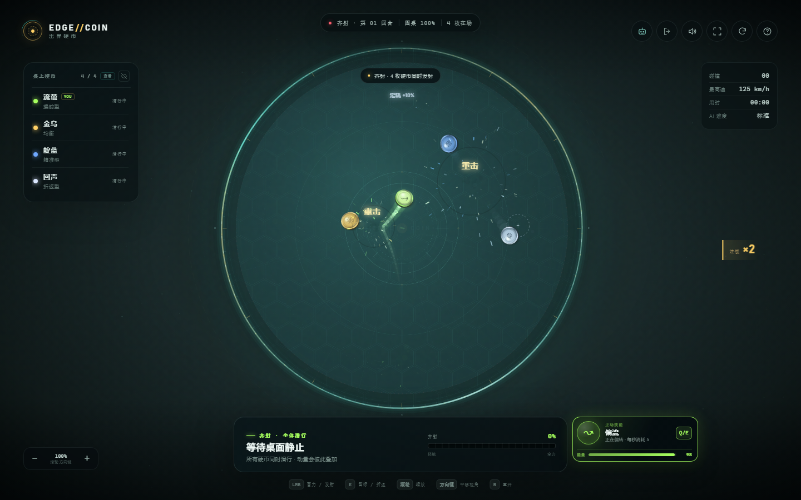

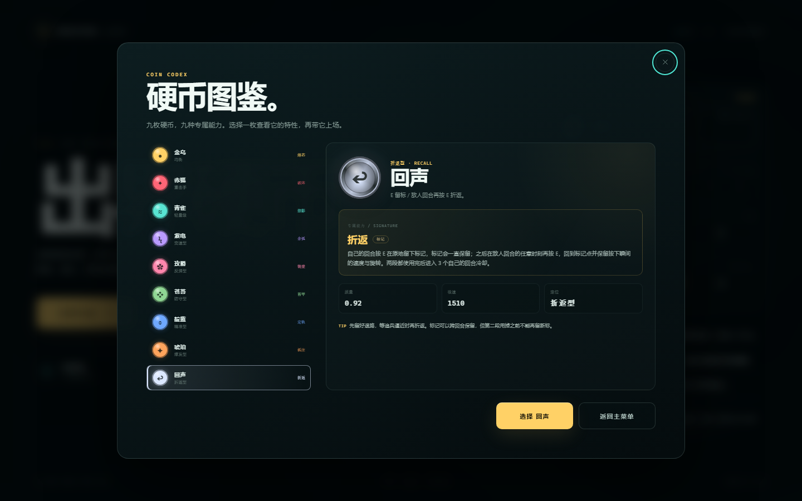

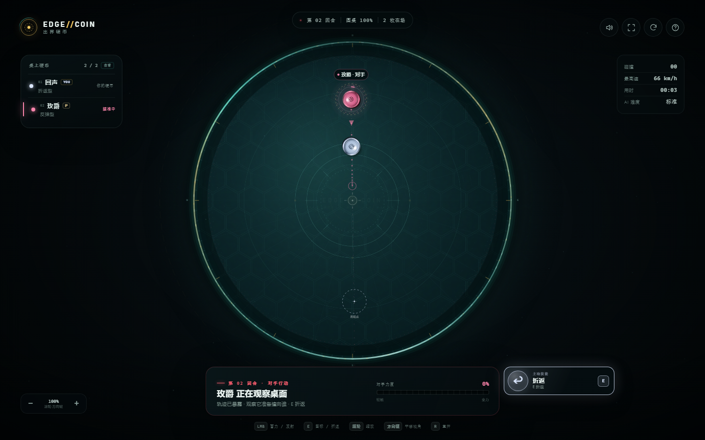

## 对局人数

- 每局玩家始终占一席，其余由 AI 随机抽取。轮流 / 追击模式为 **2–8 枚硬币**；单机齐射可调到 **2–24 枚**，硬币类型允许重复。
- **轮流模式**下，每一局开始时所有参战硬币的发射顺序都会重新随机；硬币名单的 `01–08` 就是本局顺序。
- 你的硬币始终放在场地下方，但你不一定先手。若第一个行动的是 AI，等它完成后再轮到你。
- 人数和模式选择都会保存；重开或「再来一局」会重新抽取对手。

## 对局模式

主菜单「对局模式」提供三种玩法：

### 轮流

默认模式。每回合只有一枚硬币行动，按随机顺序轮转。瞄准、蓄力、松开左键发射，然后等待桌面静止，再轮到下一枚。

**首发保护**：还没有进行过第一次发射的硬币不会被其他硬币撞飞。被撞时它保持原位，并像固定障碍一样把来球弹回去；它自己的首次发射完成后保护立即解除。名单上的「护」标记和硬币外圈的金色虚线环表示保护仍在。

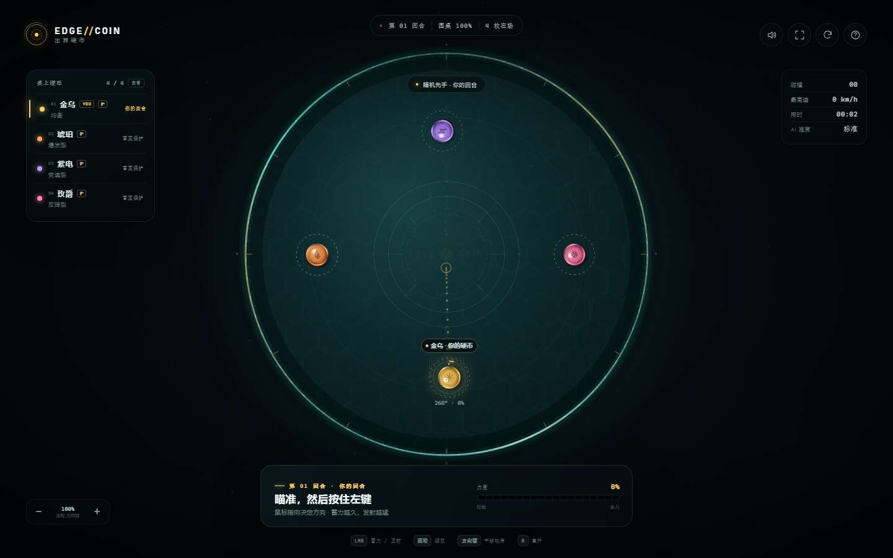

### 齐射

单机齐射支持 **2–24 枚硬币**（联机仍为 8 个房间位置）。十一种硬币可以重复出现，不需要制作新硬币；重复副本除场上位置和名单编号外，属性、尺寸、初始朝向和入场外观保持一致，外观上不再做额外区分。AI 性格仍由每名 AI 独立随机获得。

所有存活硬币在同一回合行动：

1. 你瞄准并按住左键蓄力。
2. 松开左键即**锁定**你的角度与力度，锁定后不能修改。
3. AI 会各自完成锁定，名单会显示「准备中 / 已锁定」和当前锁定数量。
4. 所有存活硬币都锁定后，倒数片刻，**全体同时发射**。
5. 桌面静止后进入下一轮齐射；如果你已出局，AI 会自动锁定并完成剩余齐射。

齐射模式没有行动顺序，名单里的 `01–08` 会隐藏。回合上限与场地收缩按**每一轮齐射**计算。

单机齐射中，松开左键后会立即完成 AI 锁定并发射，不再等待 AI 锁定延迟或额外倒数；联机齐射保留统一的锁定倒计时。

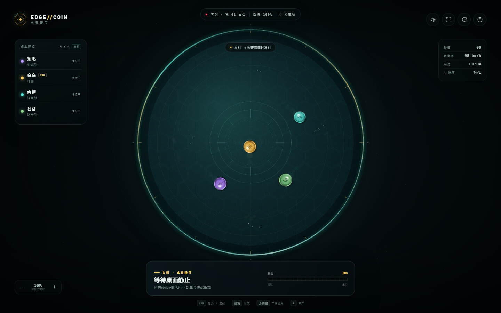

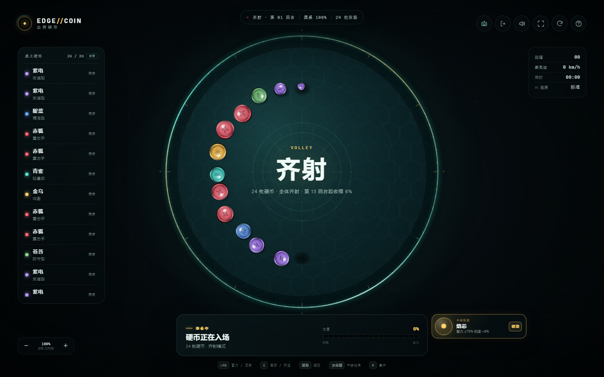

### 追击（本地）

这是一张巨大的圆形迷宫追逐战，**暂不开放联机**。

- 玩家在迷宫深处出生；`2–8` 人的设置会转换为 **1–7 名 AI 追兵**。
- 追兵刷新在玩家南侧（后方）的外圈区域，会从迷宫中追击过来。
- 玩家用鼠标瞄准、按住左键蓄力、松开进行**弹射**；硬币在迷宫中滑行并沿墙壁平滑反弹，停稳后才能再次弹射。
- 追击模式使用自定义准星鼠标：停稳时显示青色「弹射」，蓄力时变金色并显示百分比，滑行时变灰显示「滑行中」。
- 玩家完成 **3 次弹射**后追兵才会苏醒；苏醒前 HUD 会显示剩余起步次数。
- 追兵只在玩家**弹射滑行结束并停稳**后发动一次**齐射**：所有追兵同步冲刺，随后停歇；玩家再次弹射停稳后才会再次齐射。玩家滑行期间追兵会完全停火。
- 追兵拥有不同角色：猎手（直线追）、侧翼（绕侧）、伏击（预判前方）、截断（转向出口方向）、游猎（贴近骚扰）。追兵速度与冲刺强度受 AI 难度影响。
- 被追兵碰到损失 **1 点生命**，该追兵会被传送到迷宫外围；生命值可在主菜单设置为 `1–5`。
- 生命归零则失败；找到并触碰迷宫出口即可获胜。
- 出口随机生成在迷宫中，距离玩家出生点至少 **地图半径的一半**，且不会与墙壁重叠。
- 迷宫、追兵位置、出口、生命值和弹射次数都会显示在 HUD 中；出口只显示距离，不显示方向。

控制：

| 按键 | 行为 |
| --- | --- |
| 鼠标瞄准 + 左键蓄力 | 松开后弹射；硬币停稳后才能再次蓄力 |
| `R` | 重新开始追逐 |
| `H` | 暂停查看玩法 |
| `Esc` | 结算后返回主菜单 |

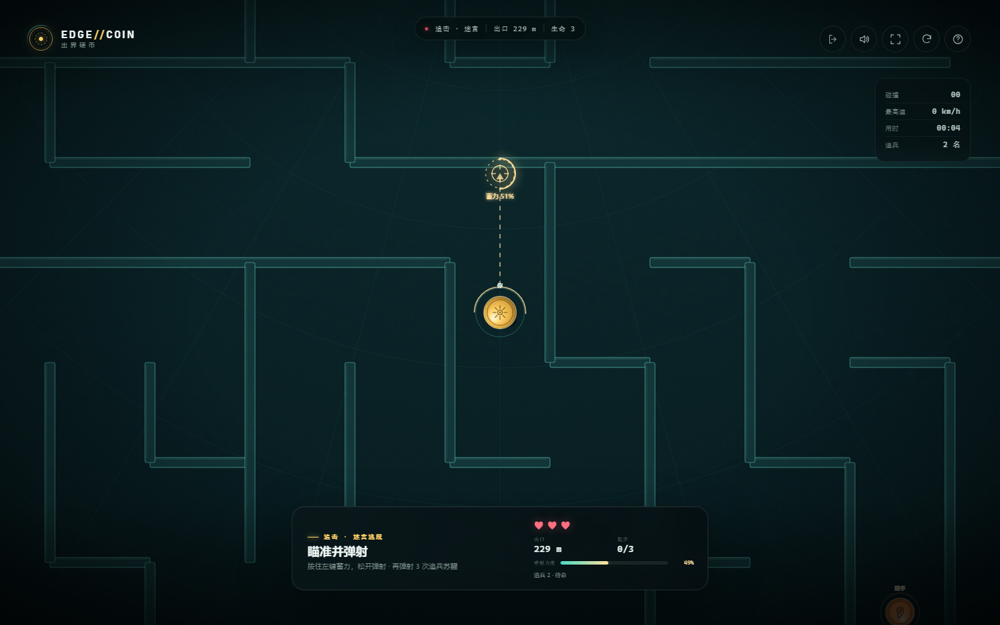

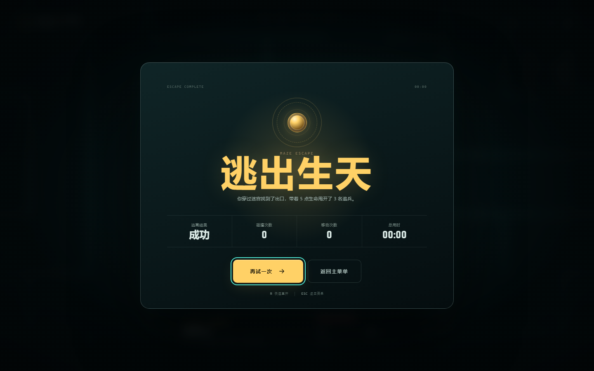

## 联机对战

联机房间固定有 **8 个位置**：房主、最多 7 名玩家，以及房主手动添加的 AI。**未满 8 人也可以开始**，至少需要 2 个已占用位置。

1. 用 `node server.js` 启动服务器，所有玩家打开同一个网址。
2. 房主在主菜单点「联机」，昵称会自动生成（可修改），直接点「创建房间」。
3. 房间创建后邀请链接会自动复制；把链接发给朋友，对方打开链接就会自动加入。也可以手动输入 5 位房间码。
4. 房主在房间里切换 **轮流 / 齐射**；点「修改地图」可以直接打开 Arena Lab 修改形状、大小、墙壁和收缩，改完回到房间会自动同步。房主还可以在房间内配置 **AI 性格池**，访客会实时看到房主的启用结果。每个空位可以添加 AI，也可以点「补齐 AI」。
5. 玩家点击自己位置上的「换硬币」可以更换自己的硬币；房主也可以更换 AI 位置的硬币。已被占用或当前正在使用的硬币不可选。更换会立即同步给全房间。
6. 房主点「开始对战」。只启用已占用的位置，空位不会进入对局。

**轮流模式**：按位置顺序行动。轮到玩家时，该玩家在自己的客户端瞄准发射；轮到 AI 时由房主客户端自动行动，其他玩家观看同步画面。

**齐射模式**：所有玩家分别锁定角度与力度，AI 自动锁定；全部锁定后由房主统一发射，所有客户端同步结算。

**15 秒倒计时**：联机中每个需要人类操作的发射/锁定阶段都有 15 秒倒计时。

- 画面顶部中央会显示大号倒计时与进度条，力度条旁还有紧凑提示。
- 轮流模式：倒计时结束仍未发射，这枚硬币的回合直接跳过，轮到下一枚。
- 齐射模式：倒计时结束仍未锁定，未锁定的硬币跳过本轮齐射；已锁定和 AI 硬币照常发射。
- 轮流模式中，如果被跳过的硬币还带首发保护，超时会立即解除保护；之后被撞会正常受力。
- 倒计时最后 5 秒会变红闪烁。
- AI 回合不显示倒计时，AI 会按自己的节奏自动出手。

- 房主客户端模拟整张桌面，其他客户端接收 20Hz 状态快照并插值渲染。
- 每位玩家占一个位置，硬币不能重复；冲突时系统自动分配空闲硬币。昵称会自动生成，避免每次输入。
- 房间内点击自己位置上的「换硬币」即可更换；房主还能更换 AI 位置的硬币。选择面板会禁用其他位置已占用的硬币，服务端也会再次校验，避免两人同时抢同一枚。
- 如果邀请链接里的局域网 IP 不可达，可以直接发送房间码让对方手动加入。
- 首发保护、十一枚硬币技能、墙壁反弹和回合收缩都会生效。
- 联机中不能暂停打开说明或硬币查看页；右上角有「离开联机」按钮。
- 有玩家掉线/离开时，当前联机对局会结束并返回主菜单。
- 结算后所有玩家都可以点「返回房间」回到联机房间；房主可以修改地图、模式、AI 后重新开始。房主也可以直接「再来一局」，其他玩家等待房主重开。
- 房间的 AI 位置由房主管理，其他玩家只能查看。
- 追击模式是本地玩法，联机房间只支持轮流 / 齐射。


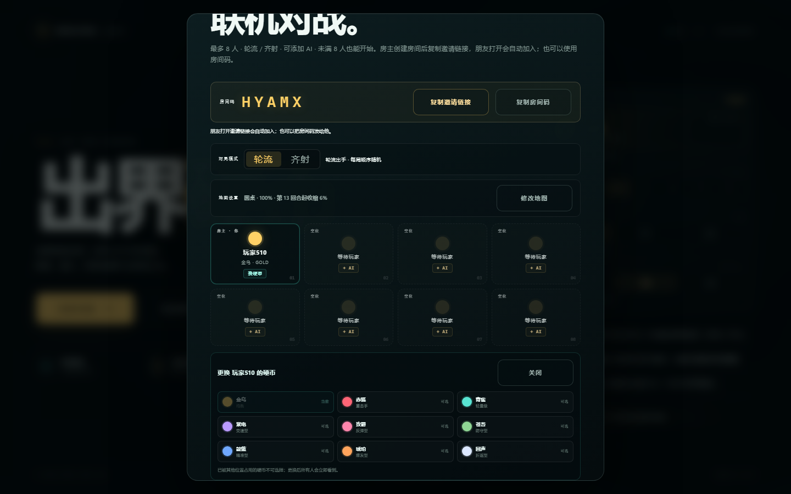

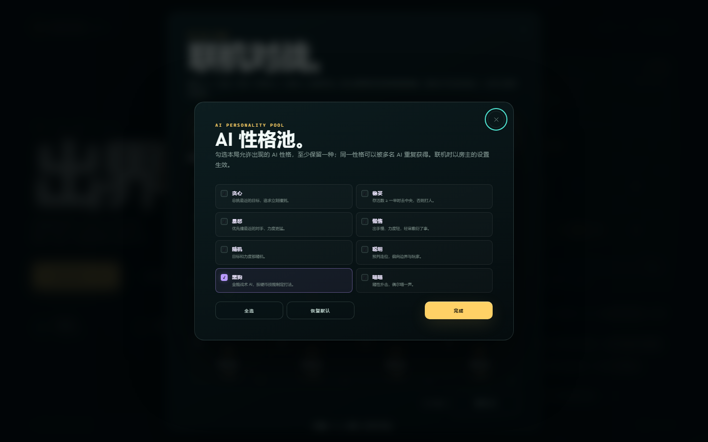

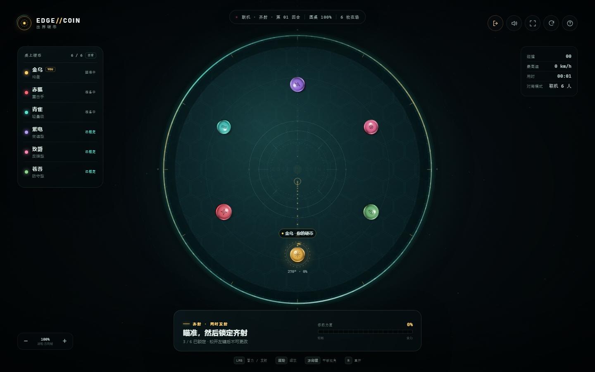

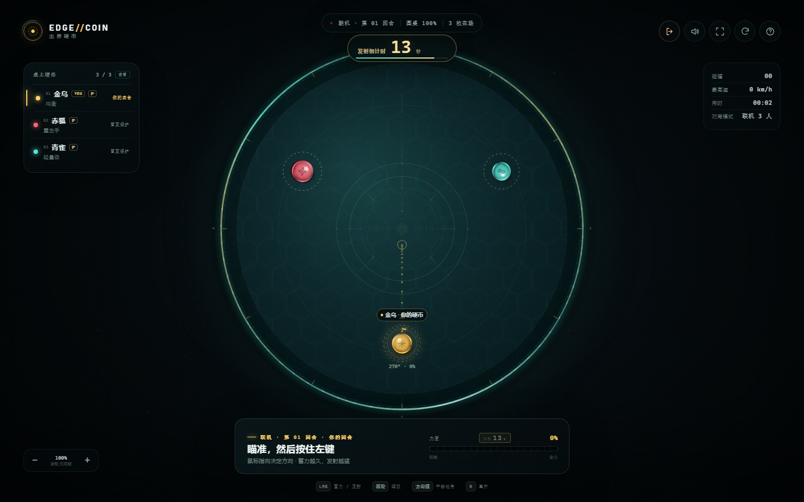

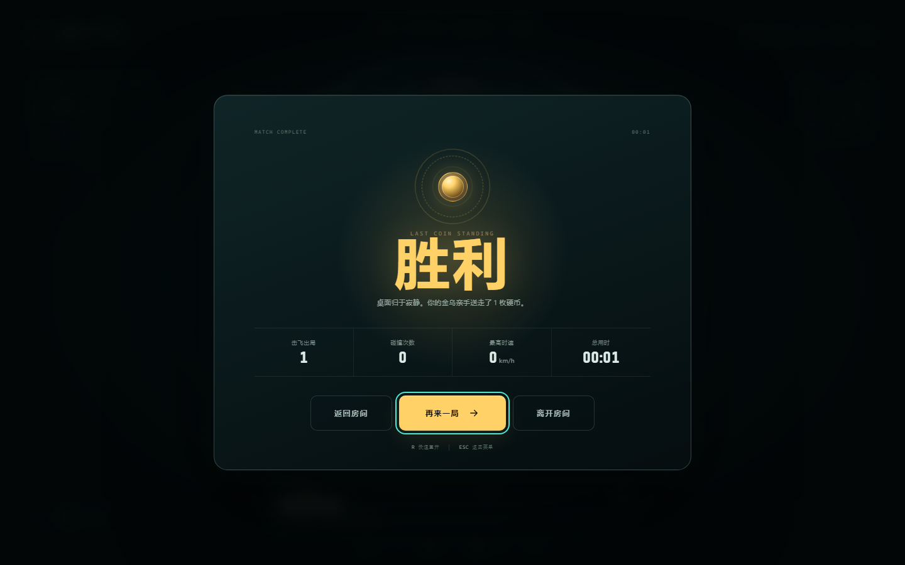

## 局内查看硬币

对局中可以用三种方式打开硬币信息页：

- 点击左侧硬币名单中的任意一枚。
- 点击名单右上角的「查看」。
- 按 `C`。

打开后对局会**完全暂停**，你可以查看本局所有硬币的专属能力、质量、极速、当前状态与存活情况，但不会改变你的出战角色。点击「继续对局」或按 `Esc` 恢复。

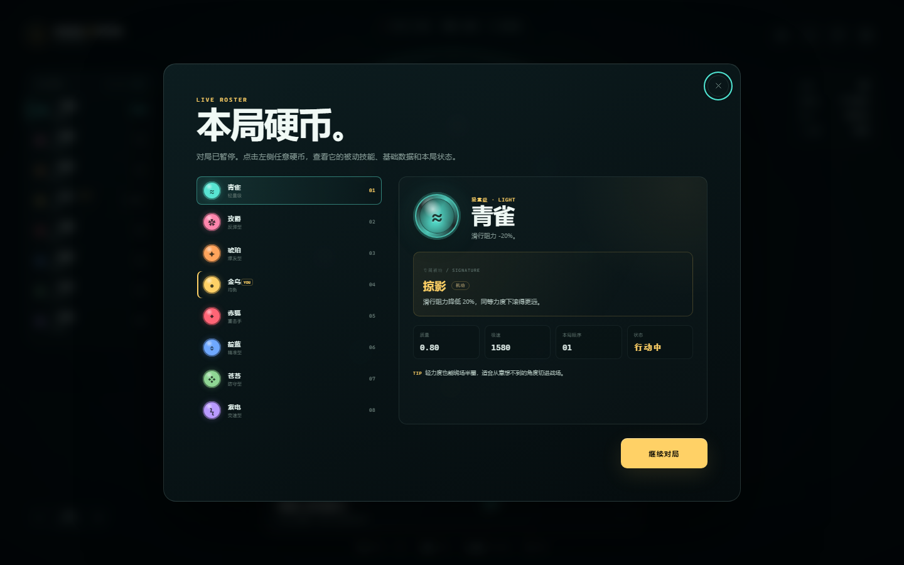

## AI 难度

主菜单硬币列表下方可选择：

- **轻松** — 瞄准更随意，失误更多，出手更慢。
- **标准** — 会认真瞄准和攻击边缘，但偶尔失手。
- **困难** — 更精准、更果断，也更倾向针对靠近开放边界的硬币。

难度设置会自动保存，游戏内右上角会显示当前难度。

## 战场

主菜单点击「场地」打开 Arena Lab：

- **圆桌** — 连续边界，没有棱角，滑行路线最难预测。
- **方阵** — 四条直边，适合折返和夹击。
- **六边** — 六个斜切角，适合把对手逼向侧边。
- **八边** — 接近圆桌但更有方向性。
- **菱阵** — 四个尖角指向上下左右，中心到四角的距离最长。

场地大小可在 **70% – 300%** 之间以 5% 调整。基础场地比早期版本更大，标准尺寸也更宽敞；场地越大，空间越多、出局越难。形状、大小和角色选择都会自动保存。

多边形场地还可以把部分直边改成 **边界墙**。硬币撞墙时会损失约四成的法向速度并反弹，切向速度也会轻微衰减，因此可以利用墙壁改变角度或把对手弹回来。无论怎么设置，**至少保留一条开放边**；只有开放边会判定出局。

## 障碍物

Arena Lab 新增「障碍物」设置，适用于**本地轮流 / 齐射**和**联机房间**（追击模式不使用）。联机时只有房主能修改，设置会同步到整个房间。

- **启用开关** — 取消勾选「启用障碍物」即可完全不生成障碍物；把数量滑到 `0` 效果相同。
- **数量** — `0 – 12`，默认 4 个。
- **类型** — 可同时启用：
  - **固定反弹**：不可移动，硬币撞上后会像撞墙一样反弹。
  - **可推动**：会被硬币撞走，移动过程中还会撞开其他硬币；自身也会与墙壁、其他障碍物碰撞。
- **形状** — 可同时选择**圆形、方形、长方形、三角**，每枚障碍物会从启用的类型与形状中随机抽取。

勾选 **「手动摆放」** 后，摆放位置不再随机：

- 在右侧 LIVE PREVIEW 中拖动障碍物即可改变位置。
- 选中障碍物后，用「选中大小」滑杆调整它的尺寸（`2.5% – 18%` 场地半径），用「旋转」滑杆调整 `0° – 360°` 朝向。
- 类型和形状按钮会作用于当前选中的障碍物；新增障碍仍会使用启用的形状池。
- 手动位置和大小会保存，并在开局时按场地比例还原。
- 取消「启用障碍物」仍可一键关闭整局障碍物；重新启用会恢复之前的手动摆放。

随机模式下，障碍物会避开硬币出生点与彼此重叠；手动模式由玩家自行决定，位置在开局时按比例还原。场地收缩时，落到新边界之外的障碍物会被移除。

联机房间中，房主可在 Arena Lab 内设置数量、类型、形状、手动位置、大小和旋转；关闭编辑器后会同步到房间。开局由房主生成并模拟障碍物，其他玩家通过状态快照看到相同的位置与运动。追击模式不使用障碍物。

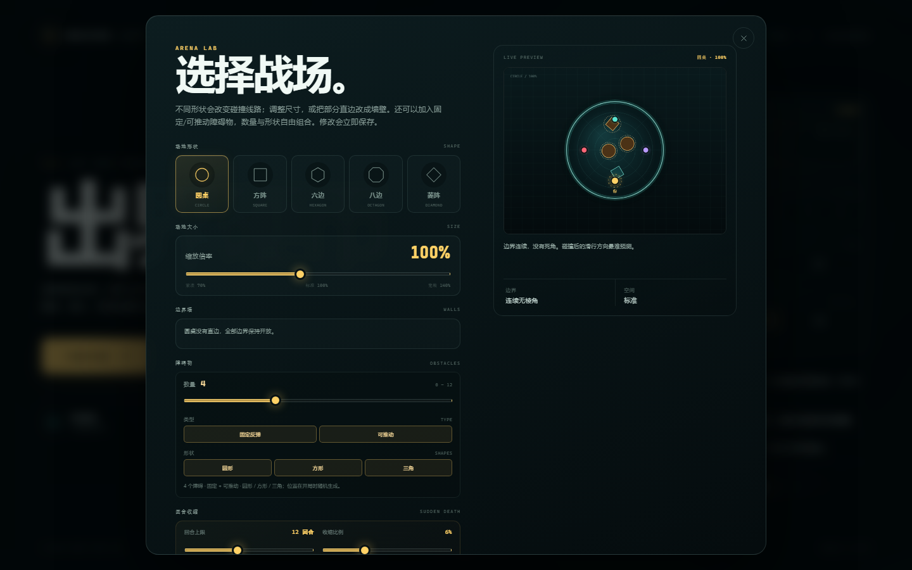

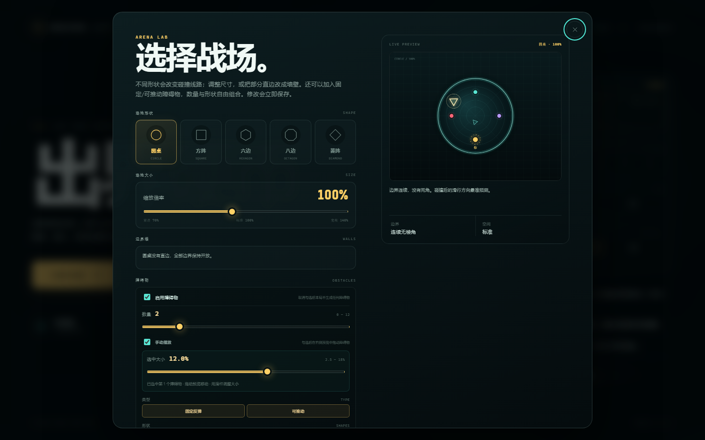

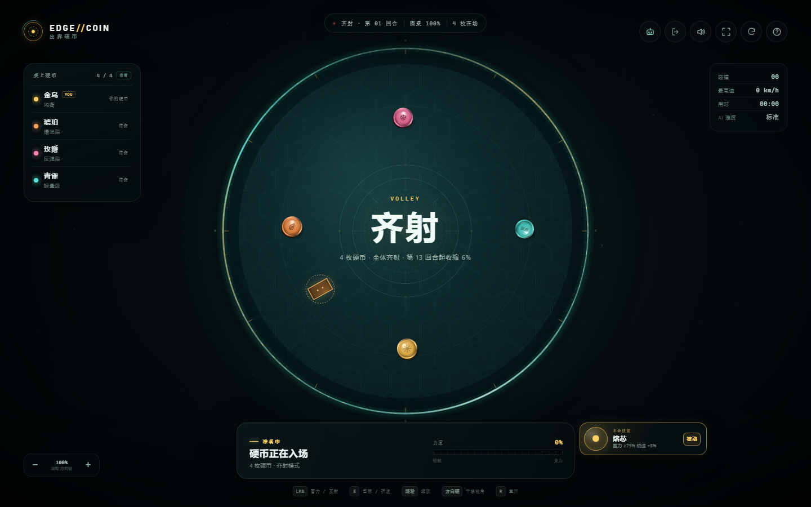

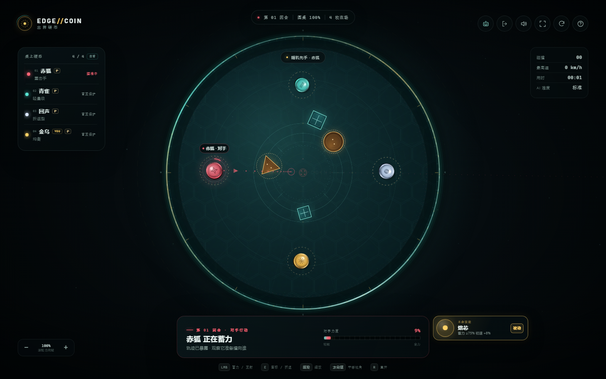

## 回合收缩

Arena Lab 的「回合收缩」可以设置：

- **回合上限** — `0` 表示不限回合；`1 – 30` 表示从下一回合开始收缩。
- **收缩比例** — 每回合把当前场地半径按 `2% – 15%` 收缩。

例如回合上限为 `12`、收缩比例为 `6%`：第 1–12 回合保持原尺寸，第 13 回合开始时缩至原半径的 94%，之后每个回合继续按当前半径累积收缩。收缩后落到新边界之外的硬币会直接出局；缩到极限时会停止继续缩小。

收缩发生时会有边界收拢闪光、屏幕震动、低频音效和提示，顶部场地标签会同步显示当前收缩比例。设置会自动保存。

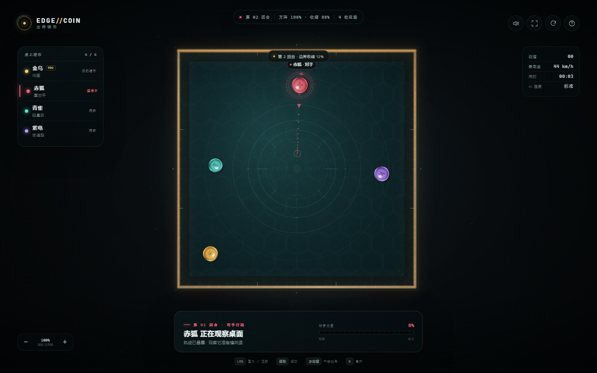

## 规则

- 硬币按所选模式行动：轮流 / 追击 2–8 枚；单机齐射最高 24 枚。轮流模式顺序随机；齐射模式所有硬币锁定后同时发射。
- 联机房间最多 8 个位置：房主、其他玩家和房主添加的 AI；至少 2 个已占用位置即可开始，未满 8 人也可以。联机可切换轮流或齐射。
- 联机由房主权威模拟；其他玩家不能暂停查看，离开会结束当前联机对局。
- 轮流模式下，尚未进行第一次发射的硬币带**首发保护**：不会被其他硬币撞飞，并会像固定障碍一样反弹来球；发射一次后保护解除。
- 本地对局中你的硬币从场地下方开始。轮流模式不一定先手；齐射模式每轮都要先锁定角度与力度。
- 边界之外没有墙，也没有固定的边界形状。硬币中心越过当前战场的开放边界即出局，不能返回。
- 台面会传递金属动量。重硬币更稳，轻硬币更快；每枚硬币的专属能力会改变碰撞或发射结果。
- 蓄力越久，滑行越远。瞄准线末端变红并出现「越过边界」时，这一杆会让你自己出局；指向墙壁时会显示「墙壁反弹」。
- 超过回合上限后，每个新回合开始时场地都会按设定比例收缩，被新边界覆盖的硬币直接出局；在齐射模式中，每一轮齐射算一个回合。
- 最后留在桌面上的硬币获胜。
- 你出局后不会立刻结束：剩余 AI 会继续自动对决，你可以平移/缩放观看，直到冠军诞生并进入结算。

## 碰撞与反馈

- 弹性碰撞、动量传递、轻微的切向摩擦和硬币自旋。
- 碰撞火花、金属音、冲击波、短促的屏幕震动。
- 重击会触发画面闪光和短暂慢动作，出局时进入更明显的慢镜头。
- 技能触发时会显示技能名与专属光效，例如「破阵」「余弧」「苔甲」「镜壁」。
- 边界危险区会以红色脉冲提示，出局时硬币会翻落并产生爆发粒子。
- 场地收缩时会出现收拢闪光、低频轰鸣、短暂震动和收缩提示。

## 技术说明

- 纯 HTML / CSS / JavaScript，无框架、无构建步骤、无外部素材。
- Canvas 2D 渲染；Web Audio API 实时合成音效。
- 2–8 人联机使用零依赖 Node 服务器：静态文件 + SSE 事件流 + POST 房间动作；8 个房间位置、房主权威模拟、AI 托管、轮流 / 齐射切换。
- 联机房间支持自动邀请链接：服务器提供局域网地址，`?join=房间码` 打开即自动加入。
- 联机房间可直接修改地图（复用 Arena Lab），设置同步到所有客户端；结算后支持返回房间继续调整并重开。
- 单机齐射上限提升至 24 枚：硬币实例使用独立 ID，类型可重复；名单、检查页、开局与结算都按 24 枚处理。轮流、追击与联机仍保持原有上限。
- 局内新增常驻技能徽章：位于底部操作面板右侧，顶边与面板上边界对齐；显示本命技能图标、名称、按键与冷却/留标状态。回声可用徽章快速确认 E 技能。
- 桌上硬币名单右上角可一键隐藏；隐藏后左上角保留「桌上硬币 · 存活数」恢复按钮，选择会保存。

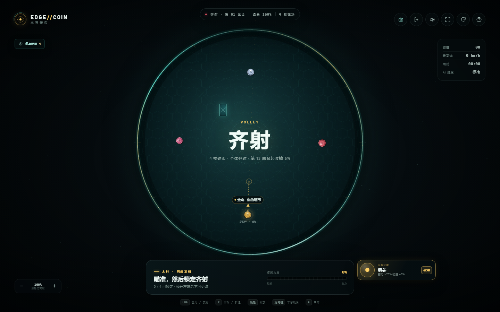

- 普通对战 AI 每局从**可配置的 AI 性格池**中随机获得性格（允许重复），影响目标、力度和等待节奏；联机由房主设置性格池并在开局时分配，通过快照同步，右上角 AI 性格按钮可查看完整名单。
- 所有单机模式支持局内退出确认：暂停当前对局，可继续或放弃并返回主菜单；联机使用独立的离开按钮。
- 联机人类回合与齐射锁定阶段有 15 秒倒计时，超时自动跳过；计时由房主权威维护，其他客户端同步显示。
- 单机齐射松手后立即结算 AI 锁定并发射，移除释放时的等待卡顿；联机保留 15 秒统一倒计时。
- 超时跳过首次回合会解除该硬币的首发保护；画面顶部大号倒计时会实时同步。
- 支持本地轮流 / 追击 2–8 枚、单机齐射最高 24 枚硬币参战、随机抽取 AI 对手；轮流模式顺序随机，齐射模式全员同时发射。
- 追击模式使用 25×25 圆形裁剪迷宫（世界半径 2000）、DFS 生成 + 少量回路、合并墙体与子步进圆形碰撞；追兵通过 BFS 寻路、角色化目标，在玩家停稳后同步齐射一次，滑行期间停火。
- 十一枚硬币拥有独立数值与专属能力，包含发射强化、冲量加成、低摩擦、碰撞加速、墙体反弹、受击减伤，以及回声的「留标 / 折返」和锚星的「急停 / 二次瞄准」主动技能。
- 独立硬币图鉴页面，可查看技能、质量、极速并直接选择出战。
- 局内硬币信息页支持点击名单或按 `C` 打开，对局会暂停，并可查看本局所有参战硬币的技能与状态。
- 轮流模式提供首发保护：未发射硬币在碰撞中按固定质量处理，不被撞飞并可反弹来球，首次发射后解除。
- 支持圆形与正多边形边界、70%–300% 场地缩放（基础半径同步增大）、可选边界墙、回合上限与逐回合累积收缩，以及动态镜头取景。
- 本地与联机轮流 / 齐射新增固定与可推动障碍物：支持 0–12 数量、两种类型混用、圆形 / 方形 / 长方形 / 三角混用，位置在随机模式下带硬币避让与间距约束，也可切换手动摆放并在预览中拖动、单独调整大小与旋转；联机由房主编辑、生成并通过快照同步，可推动障碍物使用独立质量、速度、角速度与多边形碰撞。
- 三档 AI 参数会改变瞄准误差、出手速度、目标选择、失误率与齐射锁定速度。
- 玩家出局后切换为自动观战，由剩余 AI 继续完成对局；齐射模式会自动完成所有 AI 的锁定与发射。
- 自适应 DPR 与窗口尺寸，支持桌面、平板和窄屏手机布局。
- 本地对局、图鉴和声音不依赖网络；联机需要可访问的房间服务器。

## 分享给别人

- **单文件版**：`dist/EDGE-COIN.html`。直接通过微信 / QQ / 邮件发送，对方保存后双击即可离线/本地游玩。这个版本不包含房间服务器，不能联机。
- **完整压缩包**：`dist/EDGE-COIN.zip`。解压后在目录中运行 `node server.js`，打开 <http://localhost:8130/>；本地对战和联机都可以使用。也可以把静态文件上传到 itch.io、Netlify Drop、GitHub Pages 等托管服务，但那种纯静态托管只能离线/本地对战。
- **在线链接**：要提供联机，需要把 `dist/EDGE-COIN-web/` 连同 `server.js` 部署到一台可运行 Node 的服务器，并开放对应端口。局域网内把链接中的 `localhost` 换成房主 IP 即可。

## 文件

- `index.html` — 页面结构
- `styles.css` — 视觉系统、HUD、菜单与响应式布局
- `game.js` — 物理、回合系统、AI、渲染、音效、联机客户端与交互
- `server.js` — 零依赖 Node 静态服务器、房间 API 与 SSE 转发
- `preview-codex.png` / `preview-echo.png` — 十一枚硬币图鉴与回声折返预览
- `preview-curve.png` — 流萤偏转与能量条预览
- `preview-anchor.png` — 锚星急停与二次瞄准预览
- `preview-chase.png` / `preview-chase-win.png` — 本地迷宫追击与逃脱结算预览
- `preview-quit.png` — 单机模式局内退出确认预览
- `preview-volley-24.png` — 单机齐射 24 枚硬币预览
- `preview-obstacle-editor.png` / `preview-obstacles.png` — 障碍物编辑器与局内效果
- `preview-obstacle-custom.png` / `preview-obstacle-rectangle.png` — 手动摆放与长方形障碍物
- `preview-roster-hidden.png` — 隐藏桌上硬币 UI 后的恢复按钮
- `preview-ai-personas.png` — 普通对战 AI 性格查看列表
- `preview-personality-pool.png` — AI 性格池勾选界面
- `preview-online-pool.png` — 联机房间内配置 AI 性格池
- `preview-blackdog.png` — 黑狗硬币出场闪电特效
- `preview-online-lobby.png` / `preview-online.png` — 联机大厅与对局预览
- `preview-online-coin.png` — 联机房间内更换硬币与选择面板
- `preview-online-timer.png` — 15 秒发射倒计时预览
- `preview-result-room.png` — 结算返回房间预览
